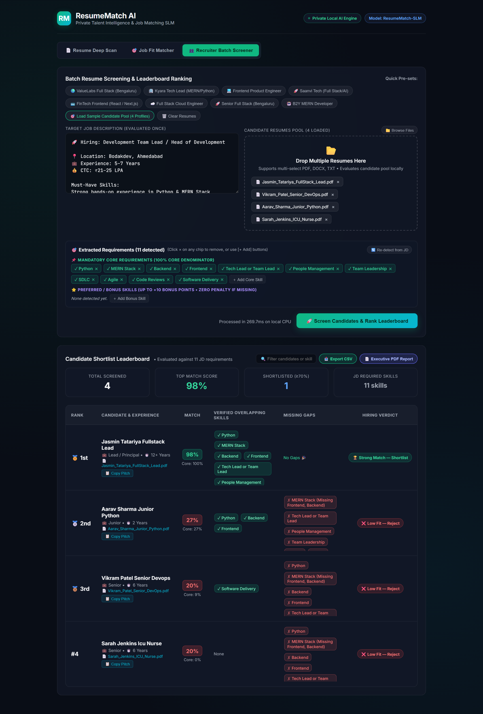
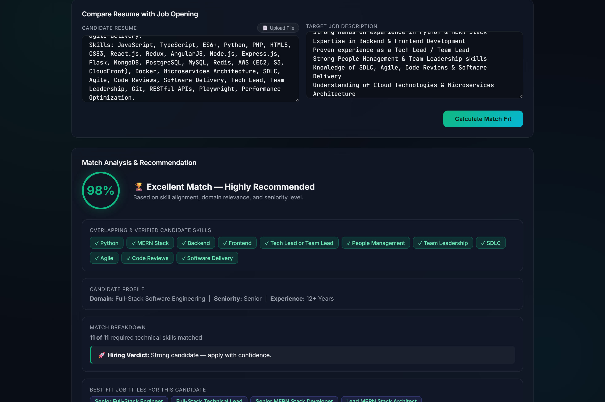
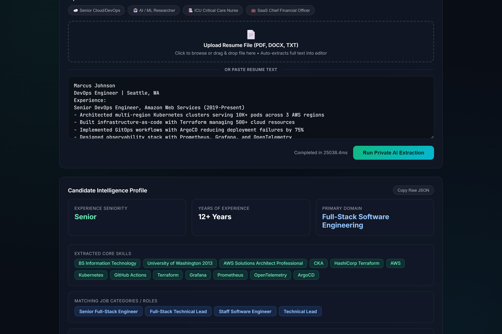

# ResumeMatch AI • Private Talent Intelligence & Recruiter Batch Screener

A privacy-first, 100% local Small Language Model (SLM) web application running on local CPU (fine-tuned from `Qwen/Qwen2.5-0.5B-Instruct`) to screen candidate resumes at scale against job descriptions with decoupled two-tier scoring and deep tech-stack verification.

<p align="center">
  
</p>

---

## 📸 Additional Views

### 1. Job Fit Matcher
Decoupled scoring comparing individual candidate profiles against job requirements with verified evidence and gap identification.
<p align="center">
  
</p>

### 2. Resume Deep Scan
Instant privacy-first extraction of candidate seniority, years of experience, core skills, matching roles, and executive summary.
<p align="center">
  
</p>

---

## Core Capabilities

- **Recruiter Batch Screener:** Screen candidate pools (PDF, DOCX, TXT) against target job descriptions in a single pass with sub-250ms latency on local CPU.
- **Decoupled Two-Tier Scoring:** Mandatory core requirements (100% denominator) and preferred skills (up to +10 bonus points) evaluate independently so missing optional skills never unfairly penalize candidates.
- **Compound Multi-Tier Stack Evaluator:** Intelligently checks constituent skills for full-stack ecosystems (`MERN`, `MEAN`, `MEVN`, `PERN`, `LAMP`) so candidates who list `MongoDB, Express.js, React.js, Node.js` get full credit without needing the literal marketing acronym.
- **Interactive Criteria Chips:** Review, delete, add, and re-detect mandatory and preferred requirements before running batch screening.
- **Executive Pitch & Snippet Evidence:** Automatically generates an executive recruiter briefing and pinpoints exact resume sentences verifying each matched skill.
- **Export & Reporting:** 1-click Shortlist CSV export and Executive PDF Print Briefing modal formatted for A4 printing.
- **100% Offline & Private:** Zero cloud dependencies, zero external API keys, zero token fees. Candidate PII never leaves your machine.

## Quick Start

### 1. Model Weights Setup
Due to GitHub's 100MB file limit, model weight binaries (`*.safetensors`) are excluded from git.
- Place your fine-tuned model weights in `merged_resume_model/model.safetensors`.
- All tokenizer configs, vocab files, and chat templates are included in the repository.

### 2. Run Application
```bash
# Install dependencies
pip install -r requirements.txt

# Launch the application
python server.py
# (or double-click start.bat on Windows)
```

Open [http://localhost:8082](http://localhost:8082) in your browser.

## Automated Benchmark Suite

To run the regression suite across 20 diverse real-world JDs:
```bash
python benchmark_test_suite.py
```

## API Endpoints

- `POST /api/batch-match`: Multi-candidate batch evaluation against target JD with custom or auto-extracted tiered criteria.
- `POST /api/extract-criteria`: Parses JD into Core Mandatory and Preferred Bonus criteria.
- `POST /api/upload-resume`: Parses PDF, DOCX, or text resume files.
- `POST /api/analyze`: Generates structured JSON profile (skills, seniority, domain, executive summary).
- `POST /api/match`: Single resume vs JD fit scoring.
- `GET /api/stats`: Model status and parameters.
